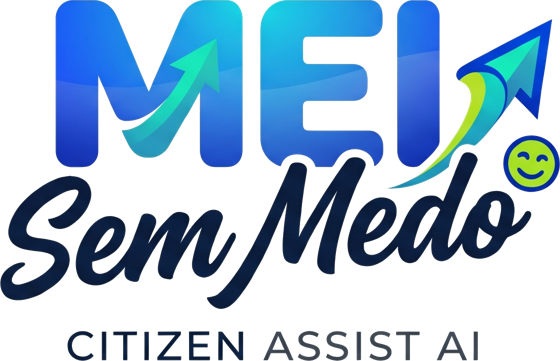
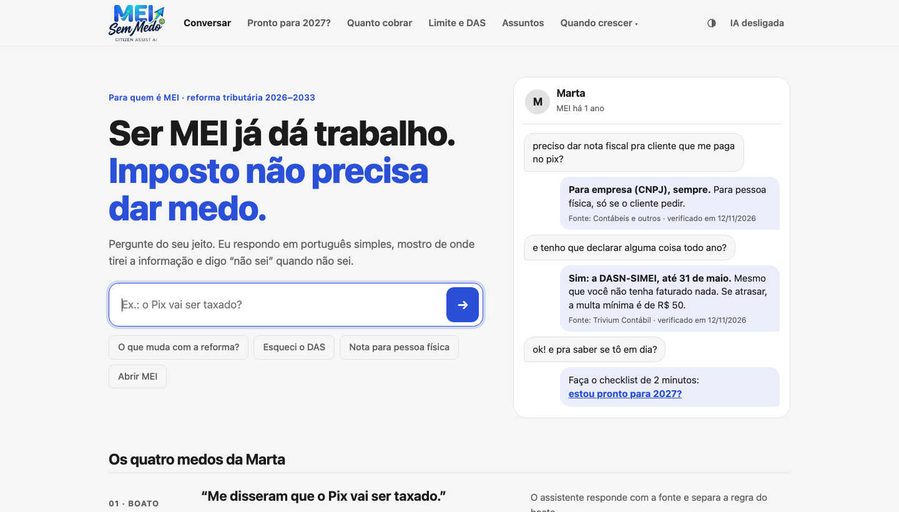
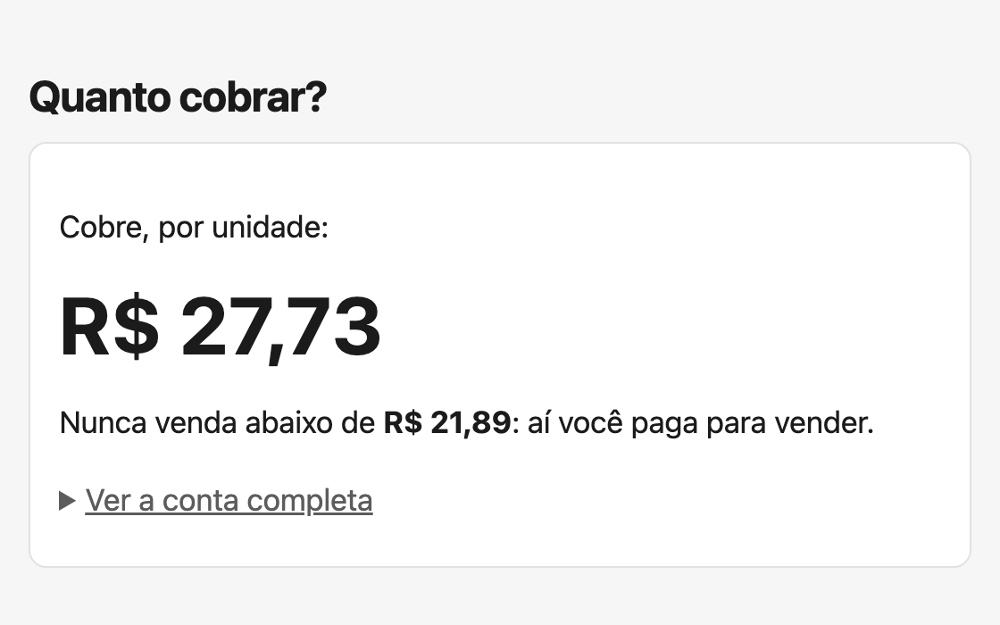

<div align="center">

<picture>
  <source media="(prefers-color-scheme: dark)" srcset="web/img/logo-escuro.png">
  
</picture>

# MEI sem Medo
**Citizen Assist AI · Global Solution 2026.2 — CitizenTech**


</div>

---

## O que é o MEI sem Medo?

<picture>
  <source media="(prefers-color-scheme: dark)" srcset="docs/img/tela-inicial-escuro.png">
  
</picture>

O MEI sem Medo é um assistente de orientação para **microempreendedores individuais (MEI)**. Quem tem um negócio pequeno encontra informação espalhada, boato ("o Pix vai ser taxado") e termos difíceis, justo quando a **reforma tributária** começa a mudar as regras (CBS, IBS, split payment, nota fiscal em 2027). O assistente recebe uma pergunta ou a escolha de um tema, procura a orientação numa **base verificada**, responde em linguagem simples **com a fonte e a data de verificação** e diz "não sei" quando a base não cobre o assunto.

**Público:** MEI e quem pensa em abrir um MEI, principalmente quem trabalha sozinho e não tem contador.
**Temas (9):** abrir o MEI, obrigações do MEI, dia a dia do negócio, preço e lucro, reforma tributária, split payment, direitos do consumidor e, para quando o negócio crescer, Simples Nacional e créditos de IBS/CBS.

> O MEI sem Medo **não é canal oficial** da Receita Federal, do Sebrae ou do Procon e não substitui um contador. Não pedimos nem guardamos dados pessoais.

**Vídeo de apresentação (YouTube, não listado):** https://youtu.be/G-9eBT6bJY8

---

## Equipe

| Nome | RM | Turma |
|---|---|---|
| Isabelle Caroline de Camargo Francisco | 572096 | 1CCOB |
| Matheus Lyncoln Souza Dias | 570765 | 1CCOB |
| Mirela Aparecida Bispo Miguel | 570830 | 1CCOB |
| Rodrigo Abrantes Mizerani | 571808 | 1CCOB |
| Vinícius Valiati | 568674 | 1CCOC |

---

## Início rápido

```bash
# Assistente no terminal (só Python 3.8+, sem instalar nada):
python src/sistema.py

# Windows
py src/sistema.py

# Site: o servidor Python serve a página e faz todas as contas
python src/servidor.py          # depois acesse http://127.0.0.1:8000
```

Os testes rodam com `python tests/testes.py`. O assistente de IA é **opcional** (veja [Assistente de IA](#assistente-de-ia-opcional)); sem ele, tudo funciona com a busca na base verificada.

---

## Menu do sistema

```
╔══════════════════════════════════════════════════════════╗
║            MEI sem Medo — assistente textual             ║
╠══════════════════════════════════════════════════════════╣
║  <pergunta>   escreva a dúvida do seu jeito   [busca]    ║
║  menu         escolher tema → assunto         [árvore]   ║
║  topicos      listar todas as orientações     [dict]     ║
║  2027         Estou pronto para 2027?         [decisão]  ║
║  sair         encerrar                                   ║
╚══════════════════════════════════════════════════════════╝
```

`python src/sistema.py --modelo B` troca o modelo de resposta (ver [Regras de resposta](#regras-de-resposta-e-modelos-de-prompt)). As calculadoras também rodam no terminal: `python src/calculadora.py`.

---

## A base de conhecimento

O arquivo `data/base.json` traz **48 orientações** em 9 temas, cada uma conferida em uma fonte identificável (Portal do Empreendedor, Receita Federal, Sebrae, Idec, textos da LC 123/2006 e da LC 214/2025 no Planalto e imprensa contábil).

| Campo | Descrição |
|-------|-----------|
| `id` | Identificador (ex.: `M1`; a letra indica o tema) |
| `tema` | Tema do registro (`mei`, `reforma`, `abrir`…) |
| `titulo` / `palavras_chave` | Usados na busca |
| `resposta` | Orientação resumida em linguagem simples |
| `fonte` / `url` | Referência consultada e link |
| `verificado` | Data da verificação (AAAA-MM-DD) |
| `confianca` | `alta` ou `confirmar` (regra ainda em regulamentação ou fontes divergentes) |
| `relacionados` | Ids de assuntos ligados (arestas do grafo) |
| `base_legal` | Opcional: lei e artigo (ex.: "LC 123/2006, art. 18-A") |

**Manutenção:** para acrescentar ou corrigir uma orientação basta editar o JSON; o código não muda. `carregar()` valida a base e trata **arquivo ausente, vazio, JSON inválido, campo faltando, id duplicado e ligação para id inexistente**, sempre com uma mensagem clara. O site lê a mesma base pelo servidor, então a correção vale no terminal e no site ao reiniciar o `servidor.py`.

| Tema | Registros | Tema | Registros |
|------|-----------|------|-----------|
| Reforma tributária | 8 | Dia a dia do negócio | 6 |
| Obrigações do MEI | 6 | Split payment | 4 |
| Direitos do consumidor | 6 | Abrir e formalizar | 3 |
| Simples Nacional (ME/EPP) | 7 | Preço e lucro | 3 |
| Créditos de IBS/CBS (ME/EPP) | 5 | **Total** | **48** (17 marcados `confirmar`) |

---

## Funcionalidades

| Recurso | O que faz | Arquivo |
|---------|-----------|---------|
| Conversa | Pergunta em texto livre → orientação + fonte + data + "veja também" | `src/sistema.py` |
| Menu de temas | Tema → assunto → resposta, com opção numerada | `src/sistema.py` |
| Estou pronto para 2027? | Checklist de sim/não em árvore de decisão; devolve as pendências por prioridade, com a fonte | `src/checklist.py`, `data/checklist2027.json` |
| Quanto cobrar | Preço de venda pelo markup divisor do Sebrae, preço mínimo e ponto de equilíbrio | `src/calculadora.py` |
| Meu limite e DAS | DAS-MEI por atividade, quanto do limite de R$ 81 mil já foi usado e o que acontece se passar | `src/calculadora.py` |
| Quando o negócio crescer | Simples Nacional, Simples puro x híbrido, créditos de IBS/CBS e split payment, para quem vira microempresa | `src/calculadora.py`, `web/` |
| Site | As mesmas funções numa página acessível (celular, teclado, leitor de tela, tema claro/escuro). A página só desenha a tela: a busca, as calculadoras e o checklist são as funções Python, chamadas pelo servidor | `web/`, `src/servidor.py` |



---

## Busca e navegação

**Estruturas:** um **dicionário** `id → registro` (acesso direto por identificador), **listas** por tema (`por_tema`) para o menu e um **grafo** de assuntos: cada registro aponta para os relacionados, somando **122 arestas** entre os 9 temas. Exemplo de caminho: *nota fiscal do MEI* (M4) → *nota obrigatória em 2027?* (R7) → *nota como prova de compra no CDC* (C7). A navegação é hierárquica no menu (tema → assunto) e em grafo no "veja também".

**Estratégia de busca (pontuação por palavras-chave):**

```
1. normaliza a pergunta: minúsculas, sem acento, sem pontuação, sem stopwords ("o", "de", "como"…)
2. para cada registro soma:  palavra-chave = 3 pts · título = 2 pts · resposta = 1 pt
                             expressão composta inteira (ex.: "nota fiscal") = +4 pts
3. ordena do maior para o menor
```

| Situação | Comportamento |
|----------|---------------|
| Melhor pontuação < 3 | **Sem correspondência:** "não encontrei na base verificada, não vou chutar", indica onde confirmar e lista os temas |
| 2º colocado de **outro tema** com ≥ 90% da pontuação do 1º | **Ambígua:** mostra as duas opções para a pessoa escolher |
| Caso contrário | Responde com o 1º colocado e sugere até 3 vizinhos no grafo |
| Entrada vazia, só símbolos, < 3 ou > 300 caracteres | Mensagem pedindo uma pergunta com palavras, com exemplo |

---

## Regras de resposta e modelos de prompt

As condicionais de `perguntar()` separam cinco casos: `vazia`, `invalida`, `ambigua`, `desconhecida` e `ok`. Registros `confirmar` sempre exibem o aviso *"esta informação pode mudar ou as fontes divergem: confirme em canal oficial"*. Nenhuma instrução é gerada fora da base.

| | Modelo A (direto) | Modelo B (estruturado) |
|---|---|---|
| Papel | Assistente informativo, não oficial | Assistente informativo, não oficial |
| Formato | Resposta + fonte + data + aviso + "veja também" | Resumo + explicação + fonte + **nível de confiabilidade** + aviso + "veja também" |
| Obrigação de citar a fonte | Sim | Sim |
| Respostas completas (fonte + data + aviso) | 36/36 | 36/36 |
| Tamanho médio | 557 caracteres | 654 caracteres |

**Comparação:** os dois são consistentes nas 36 perguntas respondidas. O **B** é mais claro quando a regra ainda está em mudança, porque mostra a confiabilidade de forma explícita; o **A** é mais curto e rápido de ler. Escolhemos o A como padrão e o B para quem quer saber o quanto confiar. A métrica mede completude, não a opinião de leitores (ver [Limitações](#conclusões-limitações-e-melhorias)). Detalhes em `docs/uso_ia.md`.

---

## Estou pronto para 2027?

Um checklist de **14 perguntas** em `data/checklist2027.json`, organizado como **árvore de decisão**: perguntas de perfil ("você vende para empresas?", "presta serviço?", "recebe por cartão ou Pix?") liberam perguntas filhas pelo campo `depende`. Quem não presta serviço, por exemplo, não é perguntado sobre a NFS-e.

```
Q4 Vende para empresas? ──sim──▶ Q5 Emite nota em toda venda para CNPJ?
                                 Q6 Sabe que o MEI não gera crédito de IBS/CBS?
Q7 Presta serviços? ─────sim──▶ Q8 Já usa o Emissor Nacional (NFS-e)?
Q11 Recebe por cartão/Pix? ─sim─▶ Q12 Sabe o que é o split payment?
```

Cada tarefa tem **peso de 1 a 3**: "sim" soma o peso; "não" e "não sei" viram pendência. O resultado é a porcentagem de pontos (≥ 80% pronto, ≥ 50% quase lá, abaixo disso atenção) e a lista de pendências **ordenada por peso**, cada uma com a dica e os registros da base para ler. A validação recusa uma tarefa que cite um registro inexistente. As respostas não são salvas nem enviadas.

---

## Testes e indicadores

`python tests/testes.py` (log completo em `docs/resultados_testes.txt`, com resposta esperada × obtida de cada pergunta).

| Indicador | Resultado |
|-----------|-----------|
| Perguntas de teste | 44: 33 diretas, 3 reformulações, 4 vazias/inválidas, 1 ambígua, 3 fora do tema |
| Taxa de acerto | 44/44 = **100%** |
| Tempo médio de consulta | 1,43 ms (máximo 1,84 ms) |
| Validação da base | 4/4 falhas simuladas tratadas (ausente, vazia, campo faltando, aresta inválida) |
| Modelos A e B | 36/36 respostas completas cada |

**Interpretação:** os 100% mostram que a busca encontra o registro certo quando a pergunta usa palavras próximas às da base, mas o conjunto foi escrito pelo próprio grupo. Ao ampliar os testes encontramos falhas reais (os sinônimos "faturar" e "cliente comum" não eram reconhecidos, e "receita" casava com receita de bolo), que corrigimos na base. O tempo mede só a busca local; numa conversa real o que pesa é o tempo de leitura.

---

## Exemplos

| Entrada | Saída |
|---------|-------|
| "Qual o limite de faturamento do MEI?" | M1: R$ 81 mil por ano · Fonte: Contmatic / Contábeis · verificado em 2026-11-12 · Base legal: LC 123/2006, art. 18-A |
| "o cliente comprou na internet e quer devolver, pode?" | C3: direito de arrependimento de 7 dias · Fonte: Idec |
| "Nota fiscal obrigatória para pessoa física em 2027?" | R7 com o aviso **confirmar**: as fontes divergem |
| "nota fiscal" | Ambígua: "é sobre a nota do MEI ou a nota como prova de compra?" |
| "como tirar passaporte?" | "Não encontrei isso na minha base verificada, então não vou chutar…" + temas cobertos |
| "" / "?!?! 123" | Pede para digitar uma pergunta com palavras, com exemplo |
| `menu` → `9` | "Opção inexistente. Digite um dos números listados." |

---

## Assistente de IA (opcional)

O site também pode responder com um modelo de linguagem, configurado no botão **IA** com a chave de API do próprio usuário. O padrão é o **Gemini**, que tem plano gratuito; Claude (modelo padrão: Haiku, o mais barato) e OpenRouter são opcionais. O modelo só pode usar as mesmas buscas e calculadoras do projeto. O código garante que **toda resposta cite um registro realmente encontrado na base**; se não citar, a resposta vira "não sei". Fontes e avisos vêm da base, nunca do modelo, e CPF, CNPJ, e-mail e telefone são removidos antes do envio. Sem chave, ou se a chamada falhar, o site volta para a busca na base. Configuração: `.env.example`.

---

## Clareza, acessibilidade e privacidade

- **Clareza:** respostas curtas em linguagem do dia a dia, termos técnicos explicados, aviso visível quando a regra pode mudar.
- **Acessibilidade:** menu numerado no terminal; no site, navegação por teclado, rótulos para leitor de tela, contraste nos temas claro e escuro e layout para celular.
- **Privacidade:** o assistente não pede nome, CPF nem CNPJ e não grava perguntas. O checklist não salva respostas. O histórico do simulador "puro x híbrido" fica só no navegador de quem usa.
- **Informação não oficial:** aviso ao iniciar e no rodapé do site; cada resposta mostra a fonte para a pessoa conferir.

---

## Estrutura de arquivos

```
MEI-Sem-Medo
├── src/
│   ├── sistema.py            # assistente textual: carga, validação, busca, grafo, menu — execute aqui
│   ├── checklist.py          # Estou pronto para 2027? (árvore de decisão e pontuação)
│   ├── calculadora.py        # preço, DAS-MEI e limite, Simples, puro x híbrido, créditos
│   ├── agente.py             # assistente de IA  (ferramentas e regras de verificação)
│   ├── provedores.py         # Gemini, Claude e OpenRouter
│   └── servidor.py           # servidor do site: entrega a base e executa as funções Python (/api)
├── data/
│   ├── base.json             # base de conhecimento verificada (48 registros)
│   └── checklist2027.json    # perguntas do checklist
├── web/                      # site (só a tela): index.html, app.js, style.css, img/
├── tests/testes.py           # perguntas de teste: acerto, tempo, validação da base e modelos A x B
├── docs/
│   ├── img/                  # capturas de tela do README
│   ├── resultados_testes.txt # log dos testes (esperado × obtido, acerto, tempo)
│   ├── uso_ia.md             # uso de IA no desenvolvimento
│   └── link_video.txt        # link do vídeo (YouTube · Não listado)
└── .env.example              # modelo de configuração da chave de API
```

---

## Requisitos

Python 3.8+ e um navegador. Não é preciso instalar bibliotecas: o projeto usa só módulos que já vêm com o Python.

| Módulo | Uso |
|--------|-----|
| `json` | Leitura e validação da base e do checklist |
| `re`, `unicodedata` | Normalização do texto na busca (acentos, pontuação) |
| `time`, `statistics` | Tempo de consulta e médias dos testes |
| `http.server`, `urllib` | Servidor local do site e chamadas HTTP do assistente de IA opcional |

O site é HTML, CSS e JavaScript só para a tela, sem bibliotecas; toda a lógica fica no Python.

---

## Conclusões, limitações e melhorias

O protótipo responde com fonte, admite quando não sabe, trata entradas inválidas e ambiguidade e liga os assuntos em grafo. O checklist transforma a orientação em ação ("o que eu resolvo primeiro?").

**Limitações:**
- A busca depende de palavras parecidas com as da base: erros de digitação e sinônimos não cadastrados caem em "não sei".
- Os testes foram escritos pelo grupo, então os 100% não garantem o mesmo desempenho com perguntas reais.
- Várias regras da reforma ainda estão em regulamentação: os 17 registros `confirmar` precisam ser revisados periodicamente.
- As simulações para microempresa são didáticas (alíquotas estimadas e editáveis).

**Melhorias possíveis:**
1. Tolerância a erro de digitação com distância de edição (`difflib`).
2. Registrar, sem dados pessoais, as perguntas que caem em "não sei" para ampliar a base.
3. Revisão mensal dos registros `confirmar`, com alerta pela data de verificação.
4. Leitura em voz alta das respostas, para quem tem dificuldade de leitura.

---

## Conceitos aplicados

`Leitura de arquivos JSON` `Validação de dados` `Tratamento de exceções` `Listas` `Dicionários` `Grafo`
`Árvore de decisão` `Busca por palavras-chave` `Pontuação e ranking` `Normalização de texto` `Stopwords`
`Condicionais e operadores lógicos` `Modelos de prompt` `Taxa de acerto` `Tempo médio de consulta`
`Acessibilidade` `Privacidade` `Reforma tributária` `MEI`

---

<div align="center">
<sub>FIAP · Global Solution 2026.2 — CitizenTech · Citizen Assist AI</sub>
</div>
